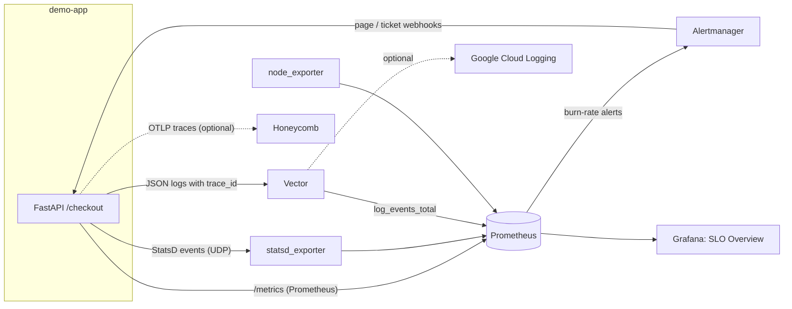

# observability-stack-ansible

[](https://github.com/surendrachallagundla301/observability-stack-ansible/actions/workflows/ci.yml)

Ansible roles that deploy a complete, self-monitoring observability stack (metrics, logs and traces) on Linux hosts, with **SLO-based alerting** for a 99.95% availability target.

One command (`ansible-playbook site.yml`) installs and configures:

| Component | Role | Port | Purpose |
|---|---|---|---|
| Prometheus | `prometheus` | 9090 | Metrics storage, recording rules, SLO burn-rate alerts |
| Alertmanager | `alertmanager` | 9093 | Routes alerts: `page` vs `ticket`, with inhibition |
| Grafana | `grafana` | 3000 | Provisioned datasource and *SLO Overview* dashboard |
| node_exporter | `node_exporter` | 9100 | Host metrics on every monitored host |
| statsd_exporter | `statsd_exporter` | 9125/udp, 9102 | Converts StatsD events into labelled Prometheus metrics |
| Vector | `vector` | 9598 | Tails JSON logs, turns them into metrics, archives them, optionally ships to Google Cloud Logging / Honeycomb |
| Demo app | `demo_app` | 8000 | FastAPI service emitting all three signals, plus a load generator |

## Architecture



Logs, metrics and traces are linked rather than kept as three separate silos: every log line carries the OpenTelemetry `trace_id` of the request that produced it, and Vector derives metrics from the logs so log-level spikes can alert in Prometheus.

## SLO alerting

The service level objective is **99.95% of requests succeed** over 30 days, giving an error budget of 0.05%. Alerts use the multi-window, multi-burn-rate method from the Google SRE Workbook:

| Alert | Burn rate | Long / short window | Severity | Budget used |
|---|---|---|---|---|
| `SLOErrorBudgetBurnFast` | 14.4x | 1h / 5m | page | 2% in 1 hour |
| `SLOErrorBudgetBurnMedium` | 6x | 6h / 30m | page | 5% in 6 hours |
| `SLOErrorBudgetBurnSlow` | 3x | 1d / 2h | ticket | 10% in 1 day |
| `SLOErrorBudgetBurnSteady` | 1x | 3d / 6h | ticket | 10% in 3 days |

The long window shows the burn is significant; the short window shows it is still happening, so alerts resolve quickly once a fix lands. The target is a single variable (`slo_target` in `inventory/group_vars/all.yml`) and all thresholds are derived from it. Every alert links to a section of the [runbook](docs/runbook.md).

To see the alerts fire, raise the demo app's error rate:

```bash
ansible-playbook site.yml -e demo_app_error_rate=0.02 --tags demo_app
```

## Quick start

Requirements: Ubuntu 22.04/24.04 target hosts with systemd, and Ansible core 2.16+ on the control machine.

```bash
git clone https://github.com/surendrachallagundla301/observability-stack-ansible.git
cd observability-stack-ansible
pip install ansible-core
ansible-playbook site.yml           # deploys to localhost by default
tests/smoke.sh                      # end-to-end check
```

Then open Grafana at http://localhost:3000 (user `admin`, password from `grafana_admin_password`; override it with Ansible Vault).

To monitor more machines, add them under `[monitored]` in `inventory/hosts.ini`. They get node_exporter, and Prometheus scrapes them automatically.

### Optional integrations

Set these in `inventory/group_vars/all.yml` (ideally encrypted with `ansible-vault`):

| Variable | Effect |
|---|---|
| `honeycomb_api_key` | Demo app exports OpenTelemetry traces, and Vector ships logs, to Honeycomb |
| `gcp_project_id` + `gcp_credentials_path` | Vector ships parsed logs to Google Cloud Logging |
| `alertmanager_slack_webhook_url` | Pages are also sent to Slack |

## Safety and reliability practices

- **Every config is validated before it is written:** `promtool check config/rules`, `amtool check-config` and `vector validate` run through Ansible's `validate:` option, so a bad template never reaches a running service.
- **Checksum-verified downloads** of every release binary against the upstream SHA256 files.
- **Idempotent:** CI runs the playbook twice and fails if the second run changes anything.
- **Reload instead of restart** where supported (Prometheus, Alertmanager), so config changes don't drop data.
- **Hardened systemd units:** dedicated non-login system user, `NoNewPrivileges`, `ProtectSystem`, `ProtectHome`.

## Testing

| Check | Command | Runs in CI |
|---|---|---|
| YAML lint | `yamllint .` | ✅ |
| Ansible lint (production profile) | `ansible-lint` | ✅ |
| Alert rule unit tests | `ansible-playbook tests/render-rules.yml && promtool test rules tests/rules_test.yml` | ✅ |
| Full deployment on a fresh Ubuntu runner | `ansible-playbook site.yml` | ✅ |
| Idempotence | second `ansible-playbook site.yml` must report `changed=0` | ✅ |
| End-to-end smoke test | `sudo tests/smoke.sh` | ✅ |

The alert rule tests feed synthetic traffic into Prometheus's rule engine and check, for example, that a 2% error rate pages within minutes, that the slower alerts stay pending, and that healthy traffic (0.01% errors) never alerts and leaves 80% of the error budget.

## Repository layout

```
site.yml                    # main playbook
inventory/                  # hosts and shared variables (SLO target, integrations)
roles/
  common/                   # system user, dirs, reusable install + systemd tasks
  prometheus/               # config, SLO + infrastructure rules
  alertmanager/             # page/ticket routing, inhibition
  grafana/                  # provisioning + SLO Overview dashboard
  vector/                   # log pipeline
  statsd_exporter/          # StatsD mapping
  node_exporter/
  demo_app/                 # instrumented FastAPI app + load generator
tests/                      # promtool rule tests, smoke test
docs/runbook.md             # what to do for each alert
```

## License

MIT
